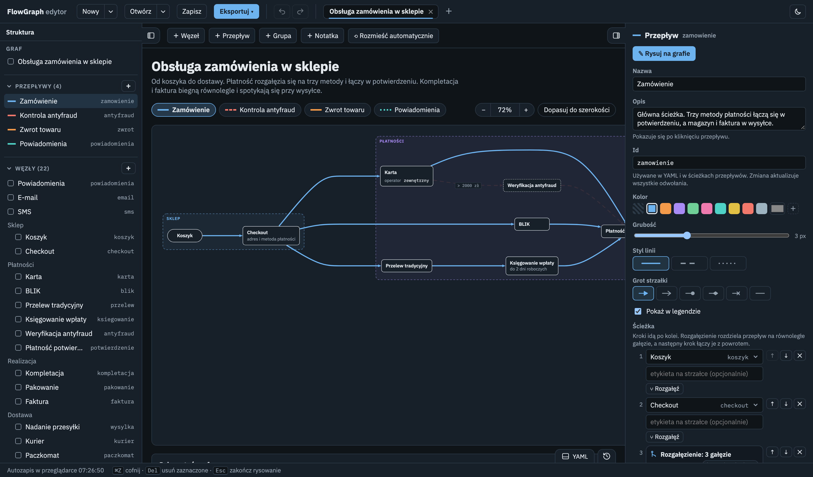
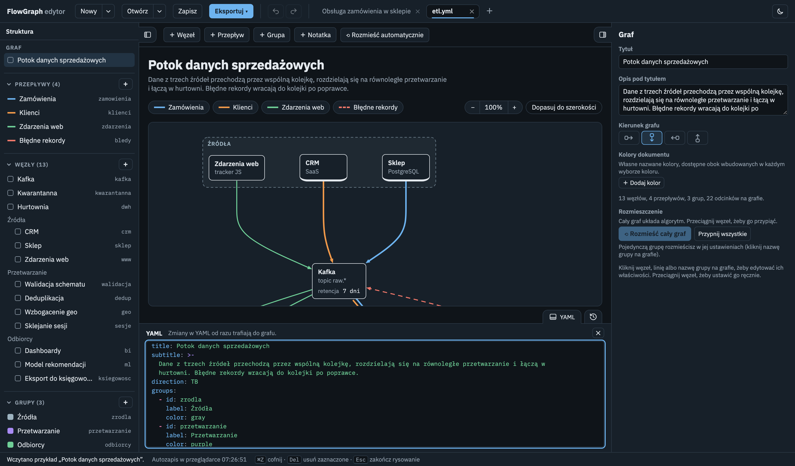
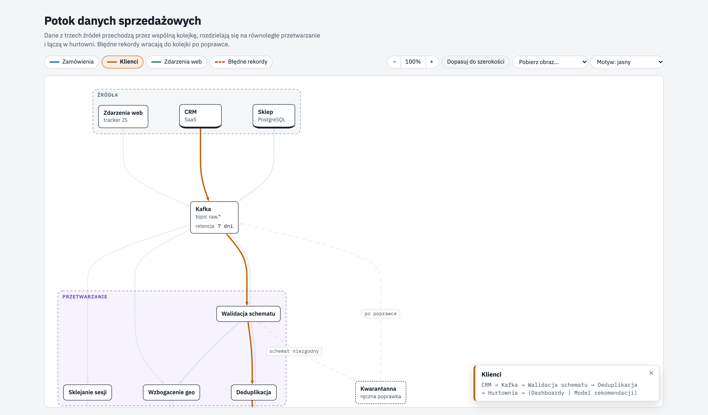
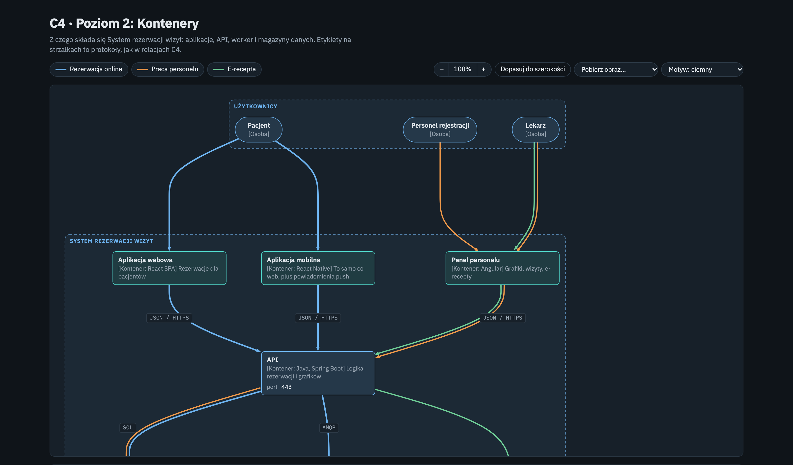

<div align="center">

# FlowGraph

[](https://github.com/pitisec/flowgraph/actions/workflows/ci.yml)
[](https://github.com/pitisec/flowgraph/releases/latest)
[](https://github.com/pitisec/flowgraph/releases)
[](LICENSE)
[](https://pitisec.github.io/flowgraph/)
[](https://github.com/pitisec/flowgraph/pkgs/container/flowgraph)
[](https://github.com/pitisec/flowgraph/releases/latest)
[](https://claude.com/claude-code)

**Grafy przepływów z prostego pliku YAML.**

</div>

Opisujesz węzły i ścieżki, którymi płyną dane, ruch sieciowy albo proces. FlowGraph sam układa graf, rysuje każdy przepływ osobnym kolorem i daje gotową, interaktywną stronę HTML. Edytor WYSIWYG działa w przeglądarce i jako aplikacja na macOS.



## Dlaczego FlowGraph

Typowy diagram pokazuje, *co jest połączone z czym*. FlowGraph pokazuje, *którędy coś płynie*. Każdy przepływ ma swoją ścieżkę przez węzły, więc kilka procesów może iść przez te same elementy, a mimo to każdy da się wyróżnić osobno. Kliknięcie w legendę przygasza resztę grafu i pokazuje opis wybranej ścieżki.

```yaml
title: Obsługa zamówienia
nodes:
  - {id: koszyk, label: Koszyk, shape: pill}
  - {id: platnosc, label: Płatność potwierdzona}
flows:
  - id: zamowienie
    label: Zamówienie
    path:
      - koszyk
      - checkout
      - [karta, blik, przelew]      # rozgałęzienie: trzy równoległe gałęzie
      - platnosc                    # ...które łączą się z powrotem
      - wysylka
```

Węzły użyte w ścieżce, a niezdefiniowane, tworzą się same, więc pierwszy graf to kilka linijek.

## Główne funkcje

### Edytor WYSIWYG

- **Struktura, podgląd, właściwości:** po lewej drzewo przepływów, węzłów, grup i notatek, w środku żywy graf, po prawej ustawienia zaznaczonego elementu.
- **Rysowanie ścieżek klikaniem:** „Rysuj na grafie” i klikasz węzły po kolei. Rozgałęzienia i złączenia dodaje się jednym przyciskiem.
- **Przeciąganie węzłów:** linie przerysowują się w trakcie ruchu. Przeciągnięty węzeł zostaje przypięty, a reszta grafu dalej układa się automatycznie.
- **Rozmieszczenie automatyczne:** całego grafu albo jednej grupy, w wybranym kierunku.
- **Zoom:** przyciski, Ctrl/⌘ albo Shift + kółko, szczypanie na gładziku. Pole grafu zawsze wypełnia okno.
- **Karty:** kilka plików otwartych naraz, każdy z własną historią i znacznikiem niezapisanych zmian. Zamykanie pliku z niezapisanymi zmianami pozwala go od razu zapisać.
- **Szybka nawigacja:** dwuklik na elemencie otwiera jego właściwości, Shift + dwuklik pokazuje go w drzewie struktury.
- **Historia zmian:** lista wszystkich zmian z automatycznym opisem. Kliknięcie wpisu przywraca dowolny wcześniejszy stan.
- **Motywy:** ciemny (domyślny), czarny, jasny albo zgodny z systemem.

### YAML i edytor zawsze zgodne



Panel YAML pokazuje plik, który edytujesz. Zmiana w tekście od razu trafia do grafu, a zmiana w grafie do tekstu. Zapisany plik jest zwięzły i czytelny dla człowieka, więc dobrze wygląda w repozytorium i w code review.

### Samodzielne strony HTML



`./flowgraph.py render plik.yml` tworzy jeden plik HTML, który działa bez serwera i bez internetu. Strona ma legendę z wyróżnianiem przepływów, opisy po kliknięciu, notatki, zoom, przełącznik motywu i pobieranie obrazu.

### Wygląd linii i węzłów

- **Węzły:** cztery kształty (prostokąt, kapsuła, element zewnętrzny, magazyn danych), podpis, właściwości `klucz: wartość` i etykiety.
- **Grupy:** zagnieżdżone ramki wokół węzłów. Ramka obejmuje też linie biegnące między węzłami grupy.
- **Linie:** kolor, grubość, styl (ciągła, kreskowana, kropkowana), etykiety na strzałkach i typ grota: strzałka, otwarta, kółko, romb, krzyżyk albo brak.
- **Kolory dokumentu:** własna paleta nazwanych kolorów, z osobną wersją dla jasnego i ciemnego motywu.

### Eksport i Mermaid

- **Obraz:** PNG, SVG i JPG, także z przezroczystym tłem. SVG to proste kształty i tekst, więc otworzysz go w Figmie i Inkscape.
- **Mermaid:** eksport do Mermaid `flowchart` („Eksportuj ▾”) i import z niego („Otwórz ▾ → Z Mermaid…”). Komentarze `%% fg:` zachowują przepływy, pozycje i paletę, więc konwersja w obie strony nic nie gubi.

### Diagramy C4



Ten sam format opisuje model C4: osoby, systemy zewnętrzne, granice systemu i kontenerów jako zagnieżdżone grupy, protokoły jako etykiety na strzałkach. Przykłady obejmują trzy poziomy: kontekst, kontenery i komponenty.

### Aplikacja na macOS

Edytor jest też natywną aplikacją (Tauri) dla Apple Silicon i Intel. Ma okna „Otwórz” i „Zapisz” systemu, menu macOS ze skrótami i listę ostatnio otwartych plików. Otwiera pliki z Findera, a gdy plik zmieni się na dysku, na przykład po `git pull`, przeładowuje graf.

## Szybki start

**Online:** [edytor w przeglądarce](https://pitisec.github.io/flowgraph/), bez instalacji. Przykładowy graf: [obsługa zamówienia](https://pitisec.github.io/flowgraph/examples/zamowienie.html).

**Docker i Kubernetes:** `docker run --rm -p 8080:8080 ghcr.io/pitisec/flowgraph`, potem http://localhost:8080. Manifest dla Kubernetes: [`deploy/kubernetes.yaml`](deploy/kubernetes.yaml).

**Aplikacja:** pobierz `FlowGraph_X.Y.Z_universal.dmg` z zakładki [Releases](../../releases) i przeciągnij FlowGraph do folderu Aplikacje.

**Przeglądarka i wiersz poleceń** (wymaga [`uv`](https://docs.astral.sh/uv/)):

```sh
./flowgraph.py editor --open                 # edytor w przeglądarce
./flowgraph.py example zamowienie > moj.yml  # przykładowy plik na start
./flowgraph.py render moj.yml --open         # YAML -> samodzielna strona HTML
./flowgraph.py to-mermaid moj.yml            # YAML -> Mermaid (wymaga node)
```

Przykłady: `zamowienie`, `etl`, `ci-cd`, `helpdesk`, `rekrutacja`, `inteligentny-dom`, `c4-1-kontekst`, `c4-2-kontenery`, `c4-3-komponenty`. Źródła YAML są w [`examples/`](examples/), a gotowe strony HTML w [`dist/examples/`](dist/examples/). Gotowy edytor w jednym pliku to [`dist/editor.html`](dist/editor.html).

## Dokumentacja

- [Pełna dokumentacja](docs/DOKUMENTACJA.md): format YAML, edytor, Mermaid, eksport, aplikacja, Docker i Kubernetes, testy.
- [Budowanie i podpisywanie aplikacji](app/BUDOWANIE.md): wersja uniwersalna, notaryzacja, wydania przez GitHub Actions i GitHub Pages.

## Rozwój

```sh
npm ci && npx playwright install chromium
npm test              # testy jednostkowe i end-to-end
npm run build         # przebudowa dist/editor.html i dist/examples/*.html
npm run build-app     # dist/ na świeżo, potem aplikacja macOS: FlowGraph.app i .dmg (app/BUDOWANIE.md)
npm run screenshots   # odświeżenie zrzutów ekranu w tym pliku
npm run release       # nowa wersja: numer, CHANGELOG, testy, commit, tag, push (app/BUDOWANIE.md, sekcja 4)
```

Commity opisujemy w formacie [Conventional Commits](CONTRIBUTING.md), a zmiany w kolejnych wersjach są w [CHANGELOG.md](CHANGELOG.md).

## Licencja

[MIT](LICENSE). Licencje użytych bibliotek: [THIRD_PARTY_NOTICES.md](THIRD_PARTY_NOTICES.md).
